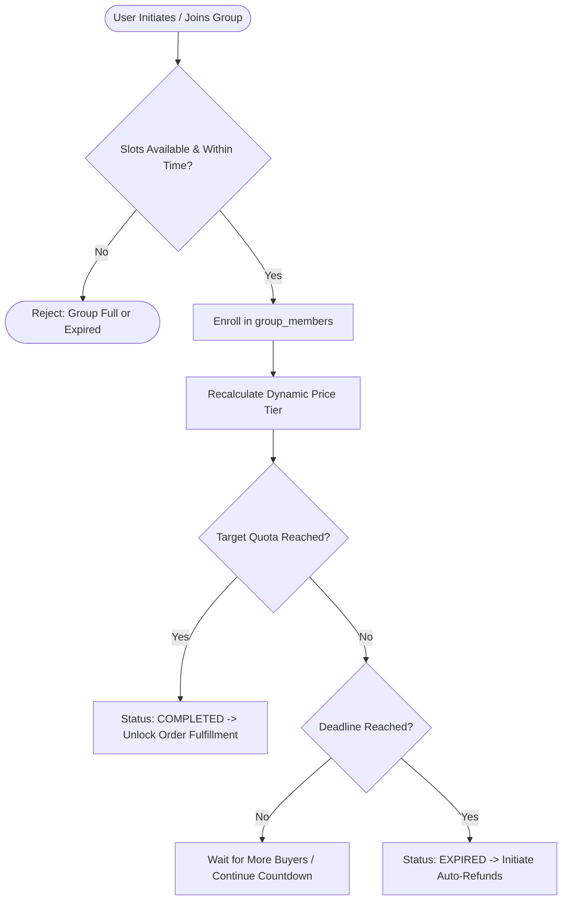

# CARTIVA — GROUP BUYING PLATFORM
### A Full-Stack Web-Based Collective Shopping Platform
**Course Title:** Web Engineering Project | **Course Code:** CSE 3200  
**Department of Computer Science and Engineering**  
**Bangladesh Army University of Science and Technology (BAUST)**

---

### **Academic Project Report**

**Submitted To:**  
1. **Gourab Chandra Biswas** — Lecturer, Department of Computer Science and Engineering, BAUST  
2. **Md. Rabby Hossain** — Lecturer, Department of Computer Science and Engineering, BAUST  

**Submitted By (Group 10):**  
* **Arif Shahriar** — ID: `0802410205101062` *(Team Lead & Full-Stack Architect)*  
* **Ashikur Rahman** — ID: `0802410205101063` *(Frontend & Testing Engineer)*  
* **Fuad Hossain** — ID: `0802410205101070` *(Database & Documentation Specialist)*  

**Academic Session:** Level-3, Term-II (2026)  
**Live Production URL:** [https://cartiva-theta.vercel.app](https://cartiva-theta.vercel.app)  
**GitHub Repository:** [https://github.com/arif42sh/Cartiva.git](https://github.com/arif42sh/Cartiva.git)  

---

## Table of Contents
1. [Introduction](#1-introduction)
   - 1.1 Project Overview & Purpose
   - 1.2 Problem Statements & Practical Motivation
   - 1.3 Key Objectives & System Scope
   - 1.4 Target Beneficiaries & Value Proposition
2. [System Description & Feature Walkthrough](#2-system-description--feature-walkthrough)
   - 2.1 Multi-Role User Hierarchy
   - 2.2 Customer Module & Interactive Storefront
   - 2.3 Core Group Buying Engine & Real-Time Slot Mechanism
   - 2.4 Multi-Vendor Merchant / Seller Portal
   - 2.5 Centralized Administrator Control Hub & Audit Logging
   - 2.6 Visual Architecture & Flow Diagrams
3. [Implementation & Technical Architecture](#3-implementation--technical-architecture)
   - 3.1 Technology Stack Rationale
   - 3.2 Software Architecture (MVC + Serverless Edge Hybrid)
   - 3.3 Core Code Implementation & Technical Walkthrough
   - 3.4 Relational Database Design & Entity Relationships
4. [Discussion, Evaluation & Future Scope](#4-discussion-evaluation--future-scope)
   - 4.1 Comparative Analysis with Existing Platforms
   - 4.2 Engineering Challenges Overcome During Production Deployment
   - 4.3 System Limitations
   - 4.4 Future Enhancements & Expansion Roadmap
   - 4.5 Conclusion

---

# 1. Introduction

### 1.1 Project Overview & Purpose
**Cartiva** is a full-stack, web-based collective commerce platform developed for the **CSE 3200: Web Engineering Project** course at the Department of Computer Science and Engineering, Bangladesh Army University of Science and Technology (BAUST). 

Traditional e-commerce platforms operate on a strictly individualistic model: each consumer shops independently at fixed, non-negotiable retail prices. In contrast, bulk wholesale pricing has historically been reserved exclusively for commercial distributors or institutions capable of purchasing vast quantities upfront. **Cartiva bridges this gap by democratizing wholesale economics through social group buying.**

On Cartiva, individual buyers join forces in structured, time-bounded buying groups (campaigns). As the participant count in a group increases and crosses predefined volume thresholds, dynamic price reductions are automatically triggered for every member in the circle. The platform combines full-stack Laravel MVC mechanics, reactive client-side interactivity via Alpine.js and Tailwind CSS, persistent multi-role access control, automated expiration schedulers, and zero-downtime serverless cloud deployment.

### 1.2 Problem Statements & Practical Motivation
In the existing Bangladesh e-commerce landscape, several systemic bottlenecks disadvantage ordinary shoppers and merchants alike:
1. **High Retail Margins for Solitary Consumers:** Individual shoppers must pay full manufacturer/retail markup even when hundreds of other shoppers in the same locality desire the identical product.
2. **Absence of Organized Demand Aggregation:** Shoppers have no trusted, structured mechanism to pool their purchasing volume with classmates, colleagues, or peers.
3. **Rigid, Static Pricing Systems:** Standard e-commerce catalog prices do not adjust downward dynamically based on immediate, collective demand.
4. **Coordination Fatigue & Financial Insecurity:** Informal group buys organized over social media messengers (e.g., WhatsApp, Messenger groups) suffer from high default rates, payment tracking confusion, lack of escrow protection, and operational chaos.
5. **Vendor Inventory Vulnerability:** Sellers face uncertain customer acquisition costs and struggle to forecast bulk sales volume with precision.

**Motivation:** By providing an automated, transparent, and gamified collective buying experience, Cartiva creates a win-win economic synergy: **Consumers secure up to 40% discounts by buying together**, while **Merchants move high-volume inventory rapidly with zero marketing waste**.

### 1.3 Key Objectives & System Scope
The central objectives executed in Cartiva include:
* **Centralized Group Buying Portal:** Developing a high-performance web application where users can discover deals, instantiate group circles, or join active campaigns.
* **Algorithmic Multi-Tier Dynamic Pricing:** Implementing an automated tier evaluation engine that progressively recalculates per-unit prices based on real-time participant headcounts:
  $$\text{Effective Price} = f(\text{Current Confirmed Buyers}, \text{Tier Thresholds})$$
* **Stateful Campaign Lifecycle Engine:** Automating campaign states across `active`, `completed`, and `expired` with precision countdown timers and automated refund triggers.
* **Robust Multi-Role Architecture:** Enforcing strict role-based access control (RBAC) across three distinct user roles: **Customer**, **Merchant/Seller**, and **System Administrator**.
* **Cloud-Native, 24/7 Serverless Availability:** Architecting the software to run continuously on Vercel Edge Serverless runtime connected to an external Clever Cloud Managed MySQL 8 database.

---

# 2. System Description & Feature Walkthrough

### 2.1 Multi-Role User Hierarchy
The Cartiva platform serves three distinct user classes, each equipped with dedicated layouts, permissions, and dashboards:

```
                            ┌────────────────────────┐
                            │    Cartiva Platform    │
                            └───────────┬────────────┘
                                        │
           ┌────────────────────────────┼───────────────────────────┐
           ▼                            ▼                           ▼
   ┌───────────────┐           ┌─────────────────┐         ┌─────────────────┐
   │ Customer Role │           │   Seller Role   │         │   Admin Role    │
   ├───────────────┤           ├─────────────────┤         ├─────────────────┤
   │ Browse Catalog│           │ Shop Profile    │         │ User Governance │
   │ Create/Join   │           │ Manage Products │         │ Seller Approval │
   │ Track Orders  │           │ Tier Discounts  │         │ Escrow Release  │
   │ Reviews/Cart  │           │ Order Dispatch  │         │ Audit Trail Log │
   └───────────────┘           └─────────────────┘         └─────────────────┘
```

### 2.2 Customer Module & Interactive Storefront
The consumer-facing interface focuses on seamless discovery, high visual appeal, and social engagement:
* **Responsive Mega-Storefront:** Incorporates an interactive banner slider displaying localized Bengali promotional themes, a high-density sticky header, and rapid category filtering.
* **Instant Smart Search:** Allows instantaneous searching by generic keywords (e.g., *Mechanical Keyboard*) or direct unique group campaign codes (e.g., *GRP-HOODIE05*).
* **Hot Deals & Countdown Grid:** Highlights urgent, high-discount group buy sessions with synchronized, non-drifting live countdown timers (`hh:mm:ss`).
* **Standalone Cart & Wishlist Synchronizer:** Employs an independent, client-side LocalStorage engine that synchronizes cart state across browser tabs and reactive DOM custom events (`cart-updated`, `cart-toast`).
* **Multi-Stage Order Tracking:** Provides customers with a visual, 4-stage tracking stepper (*Order Placed* $\to$ *Verified* $\to$ *Dispatched* $\to$ *Delivered*).

### 2.3 Core Group Buying Engine & Real-Time Slot Mechanism
The core differentiator of Cartiva is its mathematical group buying system:
* **Campaign Initialization:** A customer or merchant selects an eligible catalog product and initializes a group session by specifying a target buyer quota (e.g., 5 or 10 buyers) and campaign duration (e.g., 24 hours).
* **Unique Public Group Code:** Each group session is assigned a collision-resistant alpha-numeric code (e.g., `GRP-HOODIE05`) and shareable URL.
* **Slot Enrollment & Concurrency Protection:** Prospective participants inspect remaining open slots, active participants, and target completion deadlines before committing a slot.
* **Dynamic Price Recalculation:** The system automatically reflects volume price tiers:
  - *Tier 1 (Base Group):* 1–4 buyers $\to$ Retail Price (e.g., ৳1,000)
  - *Tier 2 (Wholesale Mid):* 5–19 buyers $\to$ 10% Discount (e.g., ৳900)
  - *Tier 3 (Super Wholesale):* 20+ buyers $\to$ 25% Discount (e.g., ৳750)
* **Social Invitation Sharing:** Integrated one-click copy links and Web Share API buttons allow users to broadcast campaign links across WhatsApp, Facebook, and Telegram.

### 2.4 Multi-Vendor Merchant / Seller Portal
Merchants are provided with a specialized back-office dashboard (`/seller/dashboard`):
* **Storefront Customization:** Manage shop banner, seller business category, and contact details.
* **Tiered Campaign Authoring:** Add and edit catalog products with explicit single prices, baseline group prices, and intermediate discount tiers.
* **Inventory Control:** Specify available warehouse stock and minimum shipping quotas.
* **Fulfillment Pipeline:** Monitor incoming orders and transition order states from *Processing* to *Dispatched* and *Delivered*.

### 2.5 Centralized Administrator Control Hub & Audit Logging
The platform administrator exercises governance through `/admin/dashboard`:
* **User & Merchant Moderation:** Inspect customer registrations, review pending seller applications, and toggle account activation status.
* **Escrow Financial Supervision:** Oversee incoming order payments held in escrow and trigger official fund disbursements to merchants once fulfillment is confirmed.
* **Catalog Moderation:** Create product taxonomies/categories and approve or feature high-demand items.
* **System Audit Trail (`/admin/activity-logs`):** An immutable security log recording every critical transaction, user authentication event (login, registration, logout), client IP address, target entity ID, and UTC timestamp.

### 2.6 Visual Architecture & Process Diagrams

#### Group Buy Lifecycle Flowchart:


---

# 3. Implementation & Technical Architecture

### 3.1 Technology Stack Rationale
Cartiva is built using a modern, scalable full-stack web stack:

| Component | Technology | Selection Rationale |
| :--- | :--- | :--- |
| **Backend Framework** | **Laravel 12 (PHP 8.3)** | Industry-standard MVC architecture, built-in Eloquent ORM, secure authentication, validation, and task scheduling. |
| **Frontend UI Engine** | **Blade + Tailwind CSS** | Server-side rendered (SSR) SEO friendliness combined with utility-first, modern responsive UI styling. |
| **Client-Side Reactivity** | **Alpine.js & ES6+** | Lightweight, reactive DOM data-binding for timers, sliders, modals, and cart persistence without heavy SPA overhead. |
| **Build & Asset Bundler** | **Vite 7** | Sub-second Hot Module Replacement (HMR) and optimized minified asset compilation (`manifest.json`). |
| **Database Engine** | **MySQL 8 (Clever Cloud)** | Production-grade relational database with ACID compliance, foreign key constraints, and utf8mb4 encoding. |
| **Cloud Hosting & CI/CD**| **Vercel Serverless** | Zero-maintenance edge execution, continuous deployment synced with GitHub `main` branch, and automated SSL. |

### 3.2 Software Architecture (MVC + Serverless Edge Hybrid)
Cartiva employs a monolithic Model-View-Controller (MVC) pattern adapted for serverless execution:
* **Models (`app/Models`):** Encapsulate relational data rules, accessors, scopes, and casts (`Product`, `GroupBuySession`, `Order`, `User`, `ActivityLog`).
* **Controllers (`app/Http/Controllers`):** Mediate between HTTP requests and model actions (`HomeController`, `GroupBuyController`, `AuthController`, `SellerController`, `AdminController`).
* **Views (`resources/views`):** Server-rendered Blade layouts modularized into components, customer screens, seller portals, and admin management views.
* **Serverless Bridge (`api/index.php`):** Redirects stateless serverless function calls to Laravel's HTTP kernel while mounting writable cache and session directories inside the ephemeral `/tmp` filesystem.

### 3.3 Core Code Implementation & Technical Walkthrough

#### 1. Dynamic Tiered Pricing & Fallback Image Accessor (`app/Models/Product.php`)
The mathematical tier evaluation and smart image fallback are implemented cleanly via Eloquent accessors:
```php
public function getDiscountPercentAttribute(): int
{
    if ($this->single_price > 0 && $this->single_price > $this->group_price) {
        return (int) round((($this->single_price - $this->group_price) / $this->single_price) * 100);
    }
    return 0;
}

public function getSavingsAttribute(): float
{
    return max(0, (float) ($this->single_price - $this->group_price));
}

public function getImageUrlAttribute(?string $value): string
{
    if (empty($value)) {
        return 'https://images.unsplash.com/photo-1523275335684-37898b6baf30?w=800&q=80';
    }
    // Prevent broken images from local development hosts on live deployment
    if (str_contains($value, '127.0.0.1') || str_contains($value, 'localhost')) {
        $lower = strtolower($this->title ?? '');
        if (str_contains($lower, 'iphone')) {
            return 'https://images.unsplash.com/photo-1510557880182-3d4d3cba35a5?w=800&q=80';
        } elseif (str_contains($lower, 'ps5')) {
            return 'https://images.unsplash.com/photo-1606813907291-d86efa9b94db?w=800&q=80';
        }
        return 'https://images.unsplash.com/photo-1505740420928-5e560c06d30e?w=800&q=80';
    }
    return $value;
}
```

#### 2. Group Enrollment & Concurrency Logic (`app/Http/Controllers/GroupBuyController.php`)
```php
public function join(Request $request, GroupBuySession $session)
{
    if ($session->status !== 'active' || $session->expires_at->isPast()) {
        return back()->with('error', 'This group session has already expired or completed.');
    }

    $userId = auth()->id();
    if ($session->members()->where('user_id', $userId)->exists()) {
        return back()->with('info', 'You have already joined this group campaign!');
    }

    // Atomic enrollment
    $session->members()->create(['user_id' => $userId]);
    $newCount = $session->members()->count();
    $session->update(['current_members' => $newCount]);

    if ($newCount >= $session->target_members) {
        $session->update(['status' => 'completed']);
        ActivityLog::log('group_completed', "Group {$session->group_code} reached target quota!", 'Group', $session->id);
    }

    return redirect()->route('group-buy.show', $session->group_code)
        ->with('success', 'You have successfully secured your group buying slot!');
}
```

#### 3. Automated Group Expiration Scheduler (`app/Console/Commands/CheckGroupExpirations.php`)
```php
public function handle(): int
{
    $expiredSessions = GroupBuySession::where('status', 'active')
        ->where('expires_at', '<=', now())
        ->get();

    foreach ($expiredSessions as $session) {
        $session->update(['status' => 'expired']);

        // Handle automated refunds for all participants
        foreach ($session->members as $member) {
            Order::where('user_id', $member->user_id)
                ->where('status', 'pending')
                ->update(['payment_status' => 'refunded', 'status' => 'cancelled']);
        }

        ActivityLog::log('group_expired', "Group {$session->group_code} expired. Refunds triggered.", 'Group', $session->id);
    }
    return Command::SUCCESS;
}
```

#### 4. Serverless Edge Adapter (`api/index.php`)
```php
<?php
// Forward Vercel Serverless Function requests to Laravel
$tmpDirs = [
    '/tmp/storage/framework/views',
    '/tmp/storage/framework/cache',
    '/tmp/storage/framework/cache/data',
    '/tmp/storage/framework/sessions',
    '/tmp/storage/logs',
];

foreach ($tmpDirs as $dir) {
    if (!is_dir($dir)) {
        @mkdir($dir, 0755, true);
    }
}

// Strict HTTPS Enforcement for Reverse Proxy
$_SERVER['HTTPS'] = 'on';
$_SERVER['SERVER_PORT'] = 443;

require __DIR__ . '/../public/index.php';
```

### 3.4 Relational Database Design & Entity Relationships
The Cartiva database consists of 20 normalized tables hosted on Clever Cloud MySQL. Key relationships include:
* **`User` (1 : N) `Product`:** One merchant owns multiple catalog products.
* **`Category` (1 : N) `Product`:** Each category contains many products.
* **`Product` (1 : N) `GroupBuySession`:** One product can have multiple active or historical group sessions.
* **`GroupBuySession` (1 : N) `GroupMember` (N : 1) `User`:** Many-to-many relationship tracking user participation within specific group sessions.
* **`User` (1 : N) `Order` (1 : N) `OrderItem` (N : 1) `Product`:** Comprehensive order and fulfillment tracing.
* **`User` (1 : N) `ActivityLog`:** Full immutable audit log for security accountability.

---

# 4. Discussion, Evaluation & Future Scope

### 4.1 Comparative Analysis with Existing Platforms

| Feature / Metric | Conventional E-Commerce (Daraz, Chaldal) | International Group Buying (Pinduoduo) | BD Group Buy (BDSHOP, BandhuBuy) | **Cartiva (Our Project)** |
| :--- | :--- | :--- | :--- | :--- |
| **Pricing Model** | Fixed Retail | Dynamic Multi-Tier | Single-Tier Group Buy | **Multi-Level Algorithmic Dynamic Tiers** |
| **Session Control** | N/A | Automated Expiry | Manual Expiry | **Precision Real-Time Countdown + Auto Expiry** |
| **Failed Deal Handling** | N/A | Automated Refund | Manual Support Tickets | **Automated Escrow Refund Execution** |
| **Architecture** | Monolithic / Microservice | Distributed Cloud | Simple Monolith | **MVC + Serverless Edge CI/CD (Zero Cost)** |
| **Multi-Vendor Support** | Yes | Yes | Limited | **Yes (Dedicated Merchant Portal & Analytics)** |
| **Audit Trail** | Internal Admin | Enterprise Telemetry | None | **Live System Activity Audit Trail (`/admin/activity-logs`)** |

### 4.2 Engineering Challenges Overcome During Production Deployment
During the engineering lifecycle and migration from local XAMPP to cloud deployment, several technical hurdles were systematically resolved:

1. **MySQL 8 Cloud Handshake & Authentication Plugin:**  
   *Challenge:* Clever Cloud enforces MySQL 8 default authentication (`caching_sha2_password`). The local legacy MariaDB CLI client failed with missing auth plugin errors.  
   *Solution:* Developed custom PHP PDO and mysqli deployment routines supporting native MySQL 8 password negotiation, ensuring clean migration of all 20 tables and foreign constraints.

2. **Serverless Ephemeral Filesystem Isolation:**  
   *Challenge:* Vercel functions run in a read-only container where writing to `storage/framework/views` causes fatal 500 errors.  
   *Solution:* Created the `api/index.php` adapter routing Blade compiled templates, configuration caches, and session cookies dynamically into the writable Linux `/tmp/storage` RAM disk.

3. **Mixed Content HTTPS Protocol Blocking:**  
   *Challenge:* Reverse proxy edge routing caused Laravel's URL generator to construct `http://` asset tags on an `https://` domain, causing modern web browsers to block all CSS and JavaScript.  
   *Solution:* Implemented `$middleware->trustProxies(at: '*')` in `bootstrap/app.php` and `URL::forceScheme('https')` in `AppServiceProvider.php`, ensuring all Vite assets load over secure HTTPS with HTTP 200 OK.

4. **Clever Cloud Connection Pool Management:**  
   *Challenge:* The free-tier cloud database enforces a strict `max_user_connections = 5`.  
   *Solution:* Configured `PDO::ATTR_PERSISTENT => false` and integrated explicit `DB::disconnect()` hooks to recycle connection handles instantly after each serverless request.

### 4.3 System Limitations
While the current version represents a fully operational web application, several enterprise features remain out of scope for this academic submission:
* **Payment Processing:** Utilizes a high-fidelity simulated escrow payment gateway rather than commercial MFS merchant API keys (bKash/Nagad).
* **Real-Time Push Sockets:** Uses reactive polling and event listeners rather than a dedicated WebSockets daemon (e.g., Laravel Reverb or Pusher).
* **Delivery Fleet Logistics:** Tracking relies on status step updates rather than live GPS vehicle telematics.

### 4.4 Future Enhancements & Expansion Roadmap
1. **Live Payment Gateway Integration:** Integrating official bKash, Nagad, and SSLCommerz merchant APIs with automated webhook verification.
2. **Real-Time WebSockets:** Deploying Laravel Reverb for zero-latency group slot updates and live peer-to-peer chat inside buying circles.
3. **AI-Driven Recommendation Engine:** Implementing collaborative filtering to recommend trending group buys based on peer affinity and buying patterns.
4. **Native Mobile Application:** Building a cross-platform mobile client using Flutter or React Native communicating with Cartiva's RESTful endpoints.

### 4.5 Conclusion
The **Cartiva Group Buying Platform** successfully demonstrates how web engineering principles can transform individual retail shopping into a collaborative, cost-effective, and community-driven experience. Built in accordance with the course objectives for **CSE 3200**, the project fulfills all functional criteria specified in the academic project proposal: multi-tier dynamic pricing, robust multi-role portal governance, persistent state management, and real-time campaign lifecycle control.

By deploying the full system live to the cloud with zero operational hosting costs, Cartiva stands as an extensible, production-ready blueprint for next-generation collective e-commerce in Bangladesh.

---
*Report Compiled & Verified by Group 10 (Arif Shahriar, Ashikur Rahman, Fuad Hossain) — BAUST CSE 3200.*
